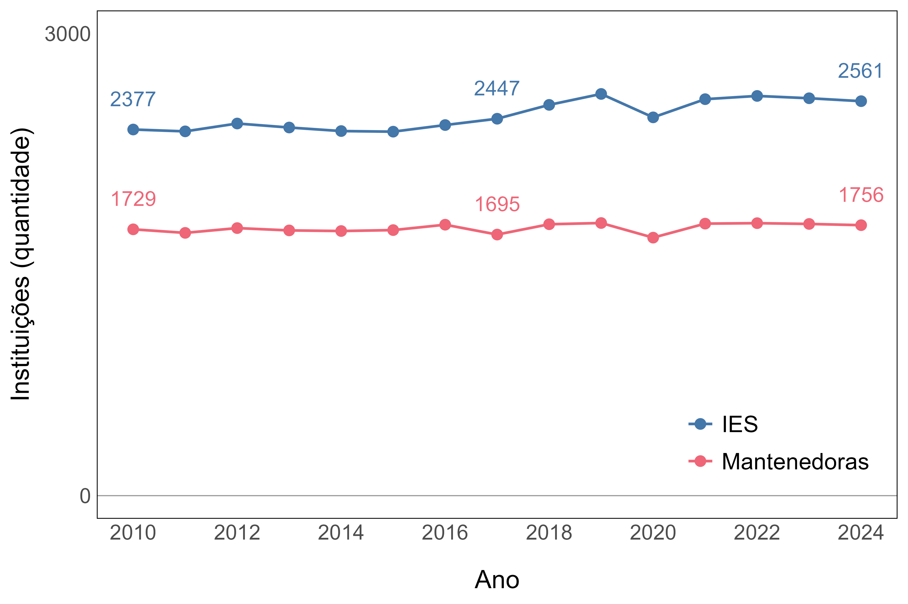
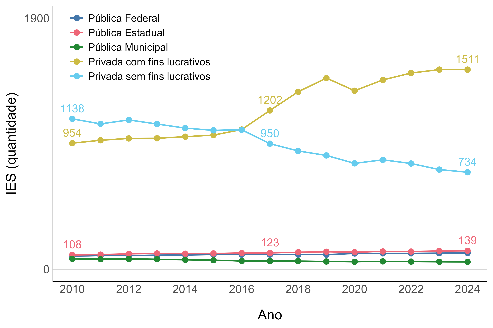
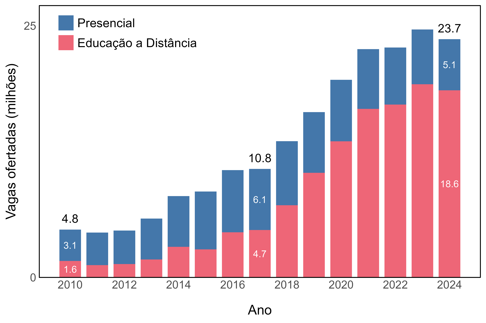
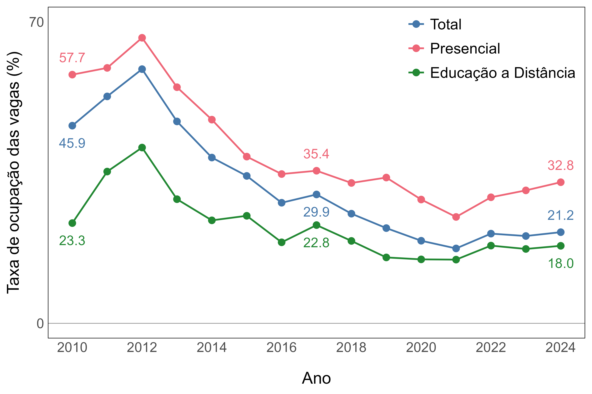
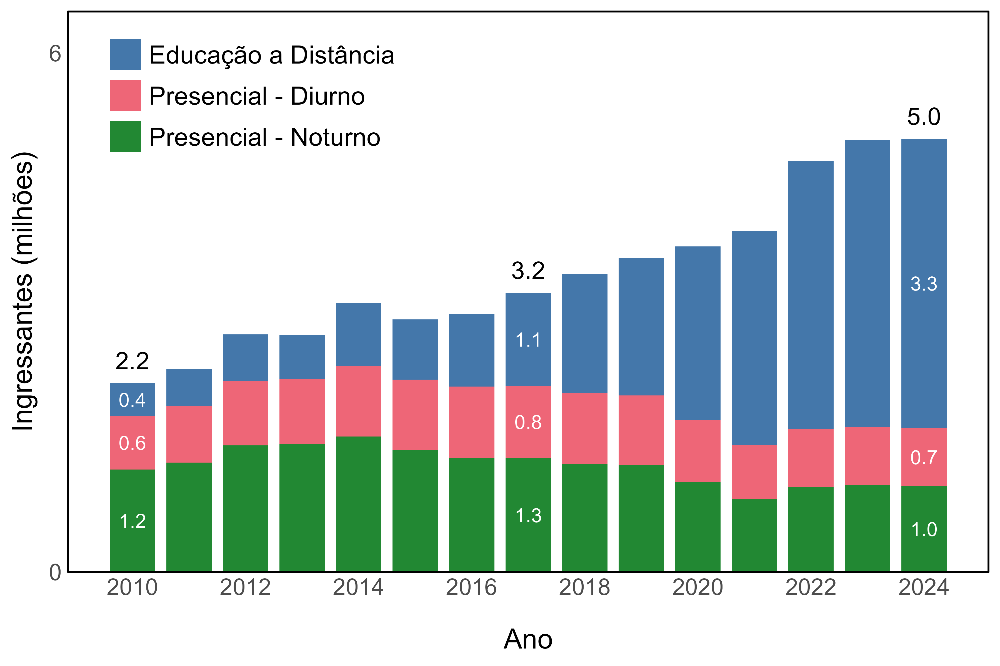
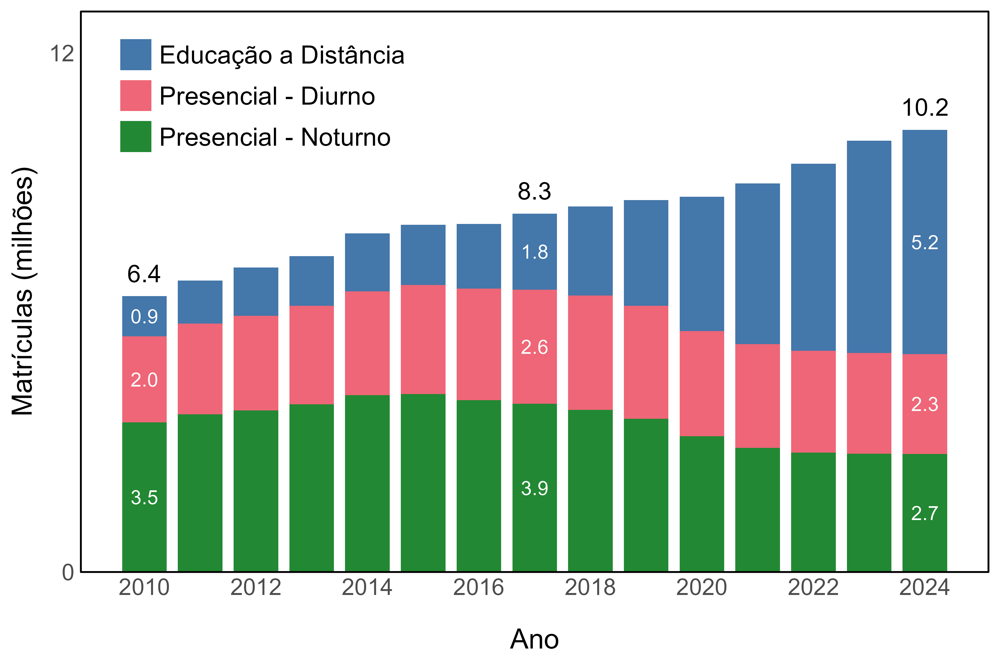
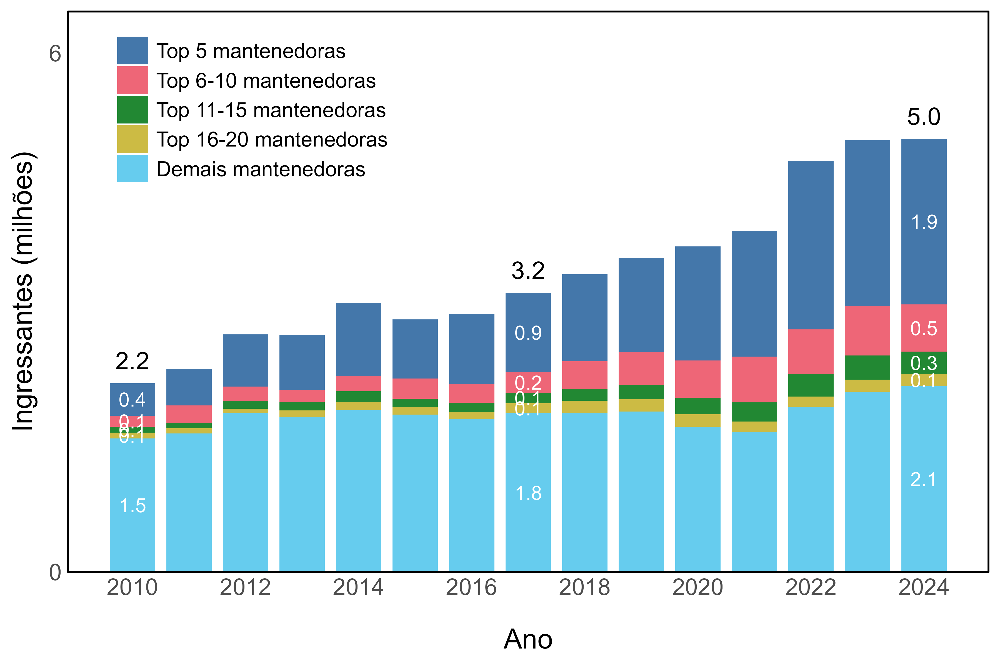
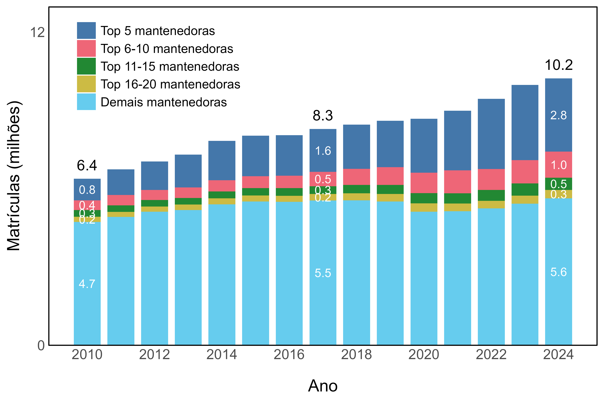
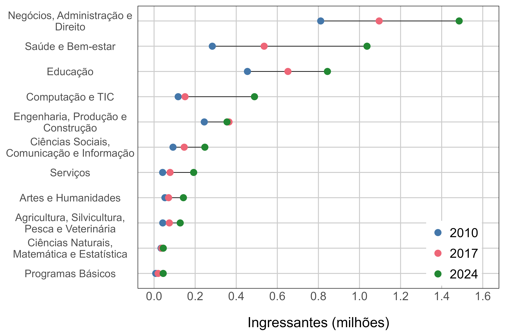
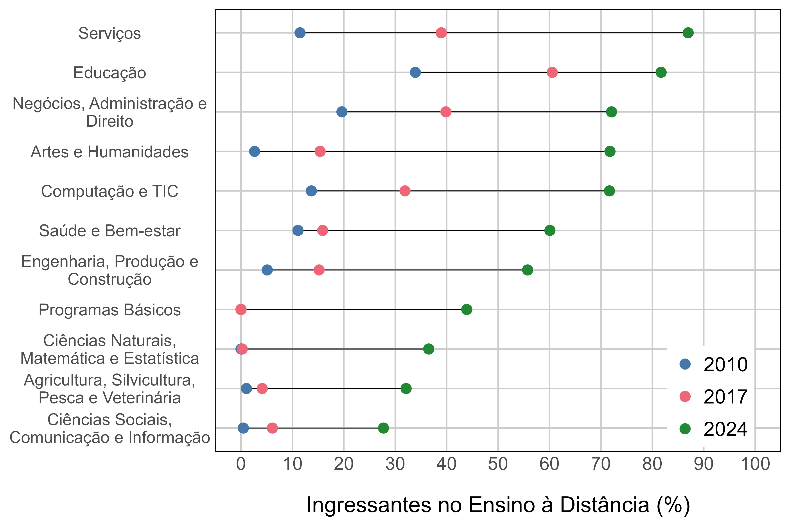

```{=openxml}
<w:p><w:r><w:br w:type="page"/></w:r></w:p>
```
```{r}
#| echo: false
#| include: false
#| message: false

# Pacotes
library(tidyverse)
library(here)
library(arrow)
library(readxl)
library(flextable)

# Caminho
here::i_am('produtos/relatorio-1/relatorio-descritivo-1.qmd')

```


# Introdução

Este relatório apresenta resultados parciais do projeto de construção de um sistema de monitoramento da educação superior brasileira, desenvolvido para subsidiar a formulação, o acompanhamento e a avaliação de políticas públicas, com ênfase na expansão da educação a distância (EaD). A análise utiliza principalmente dados do Censo da Educação Superior e acompanha as transformações ocorridas entre 2010 e 2024, comparando a evolução da EaD com a do ensino presencial.

Esta entrega contempla os oito indicadores que integram as **dimensões A — Rede Institucional e Oferta** e **B — Padrões de Crescimento do Setor**. A primeira dimensão descreve a organização da oferta, considerando a evolução das instituições de educação superior e das mantenedoras, das vagas, dos ingressantes e das matrículas. A segunda examina como o crescimento do setor se distribuiu entre diferentes segmentos institucionais, modalidades de ensino, turnos, áreas do conhecimento e faixas de tamanho das mantenedoras.

Os indicadores foram calculados para um conjunto amplo de desagregações, incluindo recortes isolados e combinações entre categoria administrativa, organização acadêmica, modalidade de ensino, turno, área do conhecimento e tamanho da mantenedora. Essa abrangência permite examinar os resultados sob diferentes perspectivas e identificar mudanças que não seriam visíveis apenas nos números agregados.

Diante do grande volume de resultados produzidos, as seções seguintes não apresentam exaustivamente todas as desagregações calculadas. Cada seção concentra-se em alguns recortes selecionados por sua relevância para a compreensão das principais tendências observadas. O relatório deve, portanto, ser entendido como uma análise descritiva parcial, destinada a destacar os achados mais importantes desta etapa e a orientar o aprofundamento das análises nas próximas entregas.

# Metodologia {#sec-metodologia}


## Fonte dos dados

Os indicadores apresentados neste relatório foram produzidos com base nos microdados anuais do **Censo da Educação Superior**, realizado pelo Instituto Nacional de Estudos e Pesquisas Educacionais Anísio Teixeira (Inep). Foram utilizadas as bases de cursos e de instituições de educação superior referentes ao período entre 2010 e 2024.

## Processamento dos dados

O processamento inicial buscou padronizar as bases anuais e construir uma série histórica comparável. Foram excluídos os cursos EaD ofertados no exterior, os cursos sequenciais de formação específica e os registros sem valores positivos nas variáveis quantitativas analisadas. A base de IES foi limitada às instituições que apresentavam ao menos um curso válido em cada ano.

Também foram produzidas variáveis harmonizadas para reduzir inconsistências cadastrais ao longo da série histórica. Esse procedimento foi especialmente importante para a categoria administrativa, pois uma mesma IES ou mantenedora pode apresentar classificações divergentes entre anos ou entre instituições vinculadas.

A categoria administrativa utilizada nos indicadores foi definida para cada combinação de mantenedora e ano. A classificação parte da categoria predominante entre as IES vinculadas à mantenedora e aplica regras adicionais para corrigir inconsistências, preservar a identificação de mantenedoras públicas e distinguir mantenedoras privadas com e sem fins lucrativos. O resultado reúne cinco categorias: pública federal, pública estadual, pública municipal, privada com fins lucrativos e privada sem fins lucrativos.

A organização acadêmica também foi harmonizada, reunindo institutos federais e centros federais de educação tecnológica em uma única categoria. Adicionalmente, as mantenedoras foram classificadas anualmente em faixas de tamanho, definidas a partir de sua posição no ranking do número de matrículas: cinco maiores, da 6ª à 10ª, da 11ª à 15ª, da 16ª à 20ª e demais mantenedoras.


# Dimensão A - Rede Institucional e Oferta {#sec-a}

## A.1 - Número e distribuição de IES e mantenedoras por categoria administrativa e organização acadêmica {#sec-a1}

```{r}
#| echo: false
#| include: false
#| message: false
#| label: code-a1

# Decomposicao da expansao de IES

## Prepara os dados para os calculos
ies.a1 <- read_parquet(here('data/clean/ces_ies.parquet')) |>
  filter(ano %in% c(2016, 2019)) |>
  select(ano, co_ies, catadm_it, co_mantenedora) |>
  mutate(ano = paste0('t', as.integer(ano == max(ano)))) |> 
  pivot_wider(names_from = ano, values_from = !c(ano, co_ies)) |>
  mutate(
    across(matches('catadm_it'), ~ replace_na(.x, -1)),
    entry = as.integer(catadm_it_t0 == -1), 
    exit  = as.integer(catadm_it_t1 == -1),
    chg_cat = as.integer(entry == 0 & exit == 0 & catadm_it_t0 != catadm_it_t1)
  )

## Decomposicao da expansao 
decomposicao.a1 <- map(
  .x = 1:5 |> set_names(), 
  .f = \(i){
    delta <- sum(ies.a1$catadm_it_t1 == i) - sum(ies.a1$catadm_it_t0 == i)
    entry <- with(ies.a1, sum(entry == 1 & catadm_it_t1 == i))
    exit  <- with(ies.a1, sum(exit  == 1 & catadm_it_t0 == i))
    net_entry <- entry - exit
    pct_net_entry <- paste0(sprintf('%.0f', 100 * net_entry / delta), '%')
    chg_cat_to   <- with(ies.a1, sum(chg_cat == 1 & catadm_it_t1 == i))
    chg_cat_from <- with(ies.a1, sum(chg_cat == 1 & catadm_it_t0 == i))
    net_chg_cat  <- chg_cat_to - chg_cat_from
    pct_net_chg_cat <- paste0(sprintf('%.0f', 100 * net_chg_cat / delta), '%')
    out <- c(delta, net_entry, net_chg_cat, pct_net_entry, pct_net_chg_cat)
    names(out) <- c('delta', 'net_entry', 'net_chg_cat', 'pct_net_entry', 'pct_net_chg_cat')
    if(delta != (net_entry + net_chg_cat)){
      print(out)
      stop("decomposicao de catadm_it com erro no saldo.")
    }
    out
    }
)

```

A @fig-01 apresenta o número de mantenedoras e de IES a cada ano entre
2010 e 2024, indicador que reflete a evolução do ensino superior no Brasil a partir
da estrutura da oferta. 

Em termos quantitativos, a expansão total foi modesta. O número de mantenedoras quase
não mudou, com crescimento de apenas 1% entre 2010 e 2024. O número de IES cresceu 
7,5% nesse período, mas a expansão concentrou-se principalmente nos anos entre 2014 e 2019. Os anos de pandemia interromperam esse processo e, nos últimos anos, houve inclusive leve declínio
no número de IES.

Em conjunto, essas tendências provocaram também relativa estabilidade no número médio de IES
por mantenedora, que oscilou em uma faixa estreita, subindo de 1,37 em 2010 para 1,46 em 2024.

{#fig-01 width=90% fig-align='center'}

::: {custom-style="FontePequena"}
Fonte: elaboração própria com base nos dados do Censo da Educação Superior.

Nota: ver @sec-metodologia para mais informações sobre fontes de dados e variáveis.
:::

A persistência dos números agregados oculta grandes mudanças de composição.
A @fig-02 apresenta a evolução do número de IES de acordo com a categoria administrativa das
mantenedoras, que revela uma profunda transformação do ensino superior privado. O número de IES de mantenedoras com fins lucrativos aumentou quase 60% entre 2010 e 2024, enquanto a quantidade de instituições de mantenedoras sem fins lucrativos recuou 36%. Esse padrão se verifica ao longo de todo o período, mas ocorreu com intensidade mais aguda entre 2016 e 2019, quando as IES privadas com mantenedoras com fins lucrativos tornaram-se a categoria mais numerosa.

Essa reconfiguração acelerada do ensino superior privado a partir de 2016 decorreu em boa medida de alterações nos dados cadastrais de IES já existentes no Cadastro e-MEC, com migração de muitas instituições da categoria "sem fins lucrativos" para "com fins lucrativos". Anteriormente raras, essas reclassificações explicam `{r} decomposicao.a1[['4']][['pct_net_chg_cat']]` do aumento do número de IES com fins lucrativos e `{r} decomposicao.a1[['5']][['pct_net_chg_cat']]` da queda do número de IES sem fins lucrativos entre 2016 e 2019. 

Ou seja, o padrão observado a partir de 2016 representa uma mudança real na composição institucional do setor privado que não deve ser interpretada simplesmente como o surgimento de centenas de novas IES com fins lucrativos e o fechamento de IES sem fins lucrativos. Uma parte importante do movimento resulta da reclassificação de IES existentes, provavelmente em função de transferências de mantença, aquisições, reorganização de mantenedoras dentro de grupos educacionais e conversão de associações sem fins lucrativos em sociedades com fins lucrativos, em um contexto regulatório que reduziu custos e barreiras para a consolidação empresarial do setor privado.[^regulacao]

[^regulacao]: Ver, por exemplo, os Decretos n. 8.754/2016, 9.057/2017 e 9.235/2017 e a Portaria Normativa MEC n. 11/2017.

{#fig-02 width=90% fig-align='center'}

::: {custom-style="FontePequena"}
Fonte: elaboração própria com base nos dados do Censo da Educação Superior.

Nota: ver @sec-metodologia para mais informações sobre fontes de dados e variáveis.
:::


## A.2 - Número de vagas oferecidas e taxa de ocupação por modalidade {#sec-a2}

A @fig-03 mostra a evolução da quantidade de vagas oferecidas por modalidade de ensino - presencial ou educação a distância - entre 2010 e 2024. Nesse período, a oferta multiplicou-se por cinco, o que corresponde a um crescimento anual de cerca de 12% no total de vagas oferecidas. As taxas de crescimento foram particularmente elevadas entre 2010 e 2021, mas houve desaceleração nos últimos anos. Em 2024, houve a primeira retração no total de vagas oferecidas em mais de uma década.

Cerca de 90% da expansão resultou da ampliação da oferta de vagas na educação a distância, que se tornou a modalidade predominante no ensino superior brasileiro. Entre 2010 e 2024, a oferta de vagas na educação a distância cresceu mais de 1000%, enquanto a oferta de vagas presenciais aumentou cerca de 60%. Com isso, a participação da eeducação a distância no total de vagas oferecidas disparou de 34% para 79%. 

Nos últimos anos, o ritmo da mudança na composição das vagas oferecidas também arrefeceu, o que pode indicar um novo equilíbrio do sistema, após uma década de inovações tecnológicas e reformas regulatórias que favoreceram a educação a distância. 

{#fig-03 width=90% fig-align='center'}

::: {custom-style="FontePequena"}
Fonte: elaboração própria com base nos dados do Censo da Educação Superior.
Nota: ver @sec-metodologia para mais informações sobre fontes de dados e variáveis.
:::

Houve um descompasso entre a oferta de vagas e a quantidade de ingressantes, como mostra a @fig-04, que apresenta a evolução da taxa de ocupação de vagas para o Brasil e por modalidade de ensino entre 2010 e 2024. A taxa de ocupação representa o número total de ingressantes por cada 100 vagas oferecidas, servindo como um *proxy* para o grau de ociosidade do sistema. 

As taxas de ocupação atingiram picos históricos em 2012, mas declinaram fortemente nos anos seguintes tanto para a educação a distância quanto para o presencial. Ou seja, ambas as modalidades registraram expansão muito mais acelerada do número de vagas do que do número de ingressantes durante a maior parte dos anos 2010. Esse descompasso torna compreensível o arrefecimento da oferta de vagas nos últimos anos, que se traduziu em alguma recuperação das taxas de ocupação, sobretudo para o ensino presencial. Ainda assim, as taxas observadas em 2024 seguem muito aquém dos valores registrados no início dos anos 2010.

{#fig-04 width=90% fig-align='center'}

::: {custom-style="FontePequena"}
Fonte: elaboração própria com base nos dados do Censo da Educação Superior.

Nota: a taxa de ocupação de vagas equivale ao número médio de ingressantes por cada 100 
vagas oferecidas. Ver @sec-metodologia para mais informações sobre fontes de dados e variáveis.
:::

## A.3 - Distribuição de ingressantes e matrículas por modalidade e turno {#sec-a3}

A @fig-05 apresenta a evolução do número de ingressantes por modalidade e turno entre 2010 e 2024. Nesse período, o total de ingressantes aumentou de cerca de 2,2 milhões para 5,0 milhões, crescimento de aproximadamente 130%. Essa expansão foi integralmente impulsionada pela educação a distância, cujo número de ingressantes aumentou quase 780%, passando de 380 mil para 3,4 milhões. 

A educação a distância ultrapassou o presencial noturno em 2018 e, a partir de
2020, passou a receber mais ingressantes do que os turnos diurno e noturno
somados. Em 2024, cerca de dois em cada três estudantes ingressaram em cursos
à distância.

Em contraste, o número de ingressantes no ensino presencial foi menor em 2024 do que em 2010. O ensino presencial diurno registrou crescimento de 36% entre 2010 e 2017, ano que registrou o pico histórico de ingressantes (838 mil), mas recuou 20% entre 2017 e 2022, estabilizando-se nos últimos anos em patamar quase idêntico ao de 2010 (cerca de 670 mil). No caso do ensino presencial noturno o período de expansão foi mais curto, com pico histórico em 2014 (1,567 milhão de ingressantes), e o declínio ainda mais acelerado, com estabilidade em torno de 1 milhão de ingressantes desde 2022. 

{#fig-05 width=90% fig-align='center'}

::: {custom-style="FontePequena"}
Fonte: elaboração própria com base nos dados do Censo da Educação Superior.

Nota: ver @sec-metodologia para mais informações sobre fontes de dados e variáveis.
:::

A mudança na composição das matrículas ocorreu de forma semelhante, mas com
alguma defasagem, como mostra a @fig-06. O número total de matrículas cresceu
cerca de 60% entre 2010 e 2024, de 6,4 milhões para 10,2 milhões. Mais uma vez,
a expansão decorreu da educação a distância, que passou de 930 mil para 5,2
milhões de matrículas, aumento de quase 460%.

No mesmo período, as matrículas presenciais diurnas cresceram apenas 16%,
enquanto as noturnas recuaram 21%. Nos dois casos, houve um breve período de expansão, seguido por forte contração e, finalmente, relativa estabilidade nos anos finais da série. O pico de matrículas no ensino presencial noturno ocorreu em 2015 (4,117 milhões) e, no diurno, em 2018 (2,647 milhões). 

A educação a distância superou o presencial noturno em 2021 e, em 2024, ultrapassou pela primeira vez a soma das matrículas presenciais diurnas e noturnas, alcançando 50,7% do total. Portanto, a expansão recente do ensino superior alterou não apenas a distribuição por modalidade, mas também reduziu fortemente a participação do turno noturno, que havia sido
o principal segmento do sistema no início da série.

{#fig-06 width=90% fig-align='center'}

::: {custom-style="FontePequena"}
Fonte: elaboração própria com base nos dados do Censo da Educação Superior.

Nota: ver @sec-metodologia para mais informações sobre fontes de dados e variáveis.
:::


## A.4 - Distribuição de ingressantes e matrículas por tamanho da mantenedora {#sec-a4}

A expansão do número de ingressantes foi acompanhada por forte aumento da
concentração nas maiores mantenedoras, como mostra a @fig-07.[^ranking] Em 2010, as cinco
maiores mantenedoras receberam cerca de 375 mil ingressantes, o que representava
pouco mais de 17% do total. Em 2024, as cinco maiores somaram mais de 1,9 milhão de ingressantes, valor correspondente a mais de 38% do total.

[^ranking]: Como explicado na seção @sec-metodologia, as faixas de tamanho de mantenedoras são recalculadas anualmente e definidas pelo número total de matrículas.

A maior concentração se torna ainda mais nítida quando alargamos o escopo para as vinte maiores mantenedoras, cuja participação no total de ingressantes saltou de 29% em 2010 para 57% em 2024. Em outras palavras, cerca de seis em cada dez ingressantes no ensino superior brasileiro estão em IES mantidas por apenas vinte das mais de 1750 mantenedoras no país (ver @sec-a1). As demais mantenedoras também registraram crescimento em termos absolutos, de 1,5 milhão para 2,1 milhões de ingressantes, mas sua participação no total recuou de 71% para 43%.

Não obstante, os resultados para os últimos anos sugerem uma desaceleração desse processo de expansão concentradora. Desde 2022 o crescimento do total de ingressantes perdeu fôlego, e a participação relativa das maiores mantenedoras declinou levemente, embora permaneça em patamar muito elevado para padrões históricos.

{#fig-07 width=90% fig-align='center'}

::: {custom-style="FontePequena"}
Fonte: elaboração própria com base nos dados do Censo da Educação Superior.

Nota: as faixas de tamanho de mantenedoras são recalculadas anualmente e definidas pelo número total de matrículas. Ver @sec-metodologia para mais informações sobre fontes de dados e variáveis.
:::

A @fig-08 revela tendência semelhante para as matrículas, embora em intensidade
menor. As cinco maiores mantenedoras saltaram de cerca de 800 mil matrículas em 2010 para o pico  de 2,9 milhões em 2023, com queda para 2,8 milhões em 2024, o primeiro recuo da série histórica. Em termos relativos, a participação das cinco maiores aumentou de 13% em 2010 para quase 29% em 2023, recuando para 27% em 2024. 

Não houve recuo no total de matrículas entre outras grandes mantenedoras, de forma que o total em 2024 para as vinte maiores representou o valor máximo da série histórica -- 4,6 milhões de matrículas, valor quase três vezes maior do que em 2010 (1,7 milhões). Em termos relativos, a parcela das vinte maiores passou de 26% em 2010 para quase 46% em 2023, com recuo bem pequeno para 45% em 2024. 

Em conjunto, os resultados indicam que a expansão do ensino superior ocorreu
de forma desproporcional nas maiores mantenedoras, sobretudo no caso dos
ingressantes. Cabe observar, contudo, que as faixas de tamanho são definidas
por rankings recalculados a cada ano. Assim, os resultados medem a
concentração entre as maiores mantenedoras de cada período, mas não acompanham
necessariamente o mesmo conjunto de instituições ao longo de toda a série.

{#fig-08 width=90% fig-align='center'}

::: {custom-style="FontePequena"}
Fonte: elaboração própria com base nos dados do Censo da Educação Superior.

Nota: as faixas de tamanho de mantenedoras são recalculadas anualmente e definidas pelo número total de matrículas. Ver @sec-metodologia para mais informações sobre fontes de dados e variáveis.
:::


## A.5 - Distribuição de ingressantes e matrículas por área de conhecimento e modalidade {#sec-a5}

A @fig-09 apresenta a distribuição dos ingressantes por área do conhecimento em
2010, 2017 e 2024. Todas as áreas registraram aumento no número de ingressantes, embora com grande heterogeneidade quanto ao *timing* e à intensidade da expansão. 

Saúde e Bem-estar registrou o maior crescimento absoluto entre 2010 e 2024,
com acréscimo de cerca de 753 mil ingressantes. Em seguida aparecem Negócios,
Administração e Direito, com aumento de 674 mil, e Educação, com 389 mil.

O sistema permaneceu concentrado em poucas áreas, apesar de
alguma diversificação ao longo do período. Em 2024, a área de Negócios, Administração e
Direito reunia 30% dos ingressantes, seguida por Saúde e Bem-estar, com
21%, e Educação, com 17%. Juntas, as três áreas concentravam pouco mais de 67% dos
ingressantes, proporção um pouco inferior aos 71% observados em 2010.

Parte significativa dessa diversificação se deu pelo dinamismo de duas áreas que ocupavam posições intermediárias em 2010: as áreas de Computação e Tecnologias da Informação e Comunicação (TIC) e de Serviços cresceram acima de 300%, com expansão concentrada no período entre 2017 e 2024. Com isso, ambas dobraram sua participação no total de ingressantes, subindo de 2% para 4% no caso de Serviços e de 5% para 10% para Computação e TIC. 

Os resultados para matrículas são qualitativamente semelhantes, indicando tímida tendência de diversificação em um sistema altamente concentrado nas áreas de Negócios, Administração e
Direito, Saúde e Bem-estar e Educação. Por isso, por motivo de espaço, omitimos o gráfico correspondente.


{#fig-09 width=90% fig-align='center'}

::: {custom-style="FontePequena"}
Fonte: elaboração própria com base nos dados do Censo da Educação Superior.

Nota: ver @sec-metodologia para mais informações sobre fontes de dados e variáveis.
:::

A expansão da educação a distância alcançou todas as áreas do conhecimento, mas
com intensidades muito diferentes, como mostra a @fig-10. Em 2010, o ensino à
distância ainda era minoritário entre os ingressantes de todas as áreas, com participação relativa maior apenas entre ingressantes em Educação (34%) e Negócios, Administração e Direito (20%). Em 2017, a educação a distância já havia avançado pelo menos 10 pontos percentuais (p.p.) em metade das áreas, tornando-se predominante em Educação (61%). Finalmente, em 2024, a educação a distância representou a maioria dos ingressantes em sete das onze áreas analisadas.

As maiores participações da educação a distância em 2024 foram observadas em
Serviços, com 87%, e Educação, com 82%. A modalidade também reunia mais de
70% dos ingressantes em Negócios, Administração e Direito, Artes e Humanidades
e Computação e Tecnologias da Informação e Comunicação. Por outro lado, sua
participação permanecia inferior a 50% em Ciências Sociais, Comunicação e
Informação, Agricultura, Ciências Naturais e Programas Básicos.

Esses resultados mostram que a transformação na composição do ensino superior
não ocorreu de maneira homogênea. Embora a educação a distância tenha avançado
em todas as áreas, a modalidade combina elevada participação em algumas das
áreas mais numerosas com avanço generalizado em áreas de diferentes perfis.

{#fig-10 width=90% fig-align='center'}

::: {custom-style="FontePequena"}
Fonte: elaboração própria com base nos dados do Censo da Educação Superior.

Nota: ver @sec-metodologia para mais informações sobre fontes de dados e variáveis.
:::


# Dimensão B - Padrão de crescimento do setor 

## B.1 - Apropriação acumulada da variação de ingressantes e matrículas por categoria administrativa, modalidade de ensino e turno  entre 2010 e 2024

A @tbl-b1 mostra que o crescimento de 3,8 milhões de matrículas entre 2010 e 2024 esteve associado a uma profunda recomposição institucional e modal do ensino superior brasileiro. A educação a distância registrou acréscimo de aproximadamente 4,3 milhões de matrículas, equivalente a 111% da expansão líquida do período. Percentuais superiores a 100% foram possíveis porque o avanço da educação a distância foi parcialmente compensado pela redução de cerca de 726 mil matrículas presenciais noturnas. O presencial diurno, por sua vez, apresentou crescimento mais moderado, de aproximadamente 314 mil matrículas.

A principal combinação responsável pela expansão foi a educação a distância oferecida por instituições privadas com fins lucrativos, com aumento de aproximadamente 4 milhões de matrículas. Esse valor, isoladamente, supera todo o crescimento líquido do sistema. Em sentido contrário, as instituições privadas sem fins lucrativos perderam cerca de 931 mil matrículas, sobretudo devido à retração de aproximadamente 936 mil matrículas no ensino presencial noturno. O crescimento de sua oferta à distância compensou apenas parcialmente essa redução.

As instituições públicas apresentaram resultados mais modestos e heterogêneos. As instituições federais se destacaram por registrar expansão razoável e concentrada em cursos presenciais, em contraste com todas as outras combinações da tabela. Já o pequeno crescimento das matrículas em instituições estaduais decorreu sobretudo da educação a distância, enquanto as municipais apresentaram leve retração. 

Em outras palavras, a expansão do sistema não representou apenas uma mudança da modalidade presencial para a educação a distância, mas também uma redistribuição da oferta em direção ao segmento privado com fins lucrativos, modificando completamente a feição do ensino superior brasileiro. 

Os resultados para a variação de ingressantes são qualitativamente semelhantes e foram omitidos por motivos de espaço.


```{r}
#| echo: false
#| include: true
#| message: false
#| label: tbl-b1
#| tbl-cap: "Variação de matrículas por categoria administrativa, modalidade de ensino e turno - Brasil, 2010/2024"

read_csv(here('results/indicadorB1.csv')) |> 
  filter(
    bloco_var %in% c('total', 'catadm_it', 'catadm_it_turno') &
    periodo == '2010-2024' & 
    serie_var %in% c('delta_qt_mat', 'pct_delta_qt_mat')
  ) |> 
    mutate(
      grupo_code = case_when(
      grupo_nome == 'Total' ~ 999999,
      grupo_code < 100 ~ 100 * grupo_code, 
      grupo_code > 100 ~ 100 * floor(grupo_code / 100),
    )
  ) |> 
  select(grupo_code, grupo_nome, serie_var, periodo, valor) |>
  pivot_wider(names_from = serie_var, values_from = valor) |> 
  arrange(grupo_code, grupo_nome) |> 
  mutate(  
    across(matches('^delta_qt'),  ~ .x / 10^3), 
    grupo_nome = str_replace(grupo_nome, '.+- ', '     ')
  ) |> 
  select(grupo_nome, delta_qt_mat, pct_delta_qt_mat) |> 
    flextable() |>
    set_header_labels(
      grupo_nome = "Grupos",
      delta_qt_mat = "Variação (milhares)",
      pct_delta_qt_mat = "Contribuição (%)"     
    ) |>
    colformat_double(j = c(2, 3), digits = 0) |>    
    bold(part = 'body', i = seq(1, 21, 4)) |> 
    italic(part = 'body', i = c(2:4, 6:8, 10:12, 14:16, 18:20)) |>
    theme_booktabs(bold_header = TRUE) |>
    align(align = "center", part = "header") |>
    line_spacing(space = 1.25, part = "all") |>
    padding(padding.top = 0.5, padding.bottom = 0.5, part = "all") |>
    width(j = 1, width = 3) |>
    width(j = c(2, 3), width = 1.57) |> 
    set_table_properties(layout = "fixed", opts_word = list(repeat_headers = FALSE))
```

::: {custom-style="FontePequena"}
Fonte: elaboração própria com base nos dados do Censo da Educação Superior.

Nota: ver @sec-metodologia para mais informações sobre fontes de dados e variáveis.
:::

## B.2 - Apropriação acumulada da variação de ingressantes e matrículas por área de conhecimento, categoria administrativa e modalidade de ensino entre 2010 e 2024

A @tbl-b2 documenta como a variação de matrículas se distribuiu pela combinação de áreas do conhecimento e modalidade de ensino. Ao contrário da seção anterior, o turno foi omitido para facilitar a leitura, dado o grande número de categorias. Mais uma vez, apresentamos somente os resultados para matrículas, mas os números para ingressantes são substantivamente semelhantes.

Todas as áreas do conhecimento apresentaram crescimento líquido das matrículas entre 2010 e 2024, embora com intensidades e composições bastante distintas. Saúde e Bem-estar respondeu pelo maior aumento absoluto, com aproximadamente 1,4 milhão de novas matrículas, equivalente a 37% da expansão total. Em seguida aparecem Computação e TIC, com acréscimo de 506 mil matrículas, Negócios, Administração e Direito, com 407 mil, e Educação, com 400 mil. Em conjunto, essas quatro áreas responderam por pouco mais de 71% do crescimento líquido.

A composição por modalidade evidencia diferentes padrões de expansão. Em Saúde e Bem-estar, houve crescimento expressivo tanto no ensino presencial quanto na educação a distância. Em Computação e TIC, quase toda a expansão decorreu da modalidade à distância. Já em Negócios, Administração e Direito e em Educação, o forte avanço da educação a distância ocorreu simultaneamente a recuos significativos do ensino presencial.

Somente duas áreas registraram maior crescimento das matrículas no ensino presencial do que na educação a distância -- Ciências Sociais, Comunicação e Informação e Agricultura, Silvicultura, Pesca e Veterinária. Essas duas áreas são as únicas que permanecem menos expostas à rápida ampliação da educação a distância, na medida em que continuam predominantemente presenciais e ainda assim vêm crescendo em ritmo digno de nota. 

```{r}
#| echo: false
#| include: true
#| message: false
#| label: tbl-b2
#| tbl-cap: "Variação de  matrículas por área do conhecimento e modalidade de ensino - Brasil, 2010/2024"

read_csv(here('results/indicadorB2.csv')) |> 
  filter(
    bloco_var %in% c(
      'total', 'co_cine_area_geral', 'co_cine_area_geral_tp_modalidade_ensino'
      ) &
    periodo == '2010-2024'
  ) |> 
    mutate(
    grupo_code = case_when(
      grupo_nome == 'Total' ~ 999999,
      bloco_var == 'co_cine_area_geral' ~ 100 * grupo_code, 
      bloco_var == 'co_cine_area_geral_tp_modalidade_ensino' ~ 100 * floor(grupo_code / 100)
    )
  ) |>  
  select(grupo_code, grupo_nome, serie_var, periodo, valor) |>
  pivot_wider(names_from = serie_var, values_from = valor) |> 
  arrange(grupo_code, grupo_nome) |> 
  mutate(  
    across(matches('^delta_qt'),  ~ .x / 10^3), 
    grupo_nome = str_replace(grupo_nome, '.+- ', '     ')
  ) |> 
  select(grupo_nome, delta_qt_mat, pct_delta_qt_mat) |> 
    flextable() |>
    set_header_labels(
      grupo_nome = "Grupos",
      delta_qt_mat = "Variação (milhares)",
      pct_delta_qt_mat = "Contribuição (%)"
    ) |>
    colformat_double(j = c(2, 3), digits = 0) |>    
    bold(part = 'body', i = seq(1, 34, 3)) |> 
    italic(part = 'body', i = c(2:3, 5:6, 8:9, 11:12, 14:15, 17:18, 20:21, 23:24, 26:27, 29:30, 32:33)) |>
    theme_booktabs(bold_header = TRUE) |>
    align(align = "center", part = "header") |>
    line_spacing(space = 1.25, part = "all") |>
    padding(padding.top = 0.5, padding.bottom = 0.5, part = "all") |>
    width(j = 1, width = 3) |>
    width(j = c(2, 3), width = 1.57) |> 
    set_table_properties(layout = "fixed", opts_word = list(repeat_headers = FALSE))
```


::: {custom-style="FontePequena"}
Fonte: elaboração própria com base nos dados do Censo da Educação Superior.

Nota: ver @sec-metodologia para mais informações sobre fontes de dados e variáveis.
:::

## B.3 - Apropriação acumulada da variação de  ingressantes e matrículas por tamanho de mantenedora entre 2010 e 2024

A @tbl-b3 apresenta a variação do número de matrículas entre 2010 e 2024 para combinações de faixas de tamanho de mantenedora, modalidade de ensino e turno. Como discutido na @sec-a4, a expansão de matrículas foi altamente concentrada entre as grandes mantenedoras, ainda que todas as faixas tenham registrado aumento líquido.

A faixa das cinco maiores apresentou crescimento de aproximadamente 2 milhões de matrículas, correspondente a mais da metade da expansão líquida. Consideradas conjuntamente, as vinte maiores responderam por quase 3 milhões de novas matrículas, ou 76% do saldo total. Todas as outras mantenedoras - grupo com mais de 1700 mantenedoras - contribuíram com apenas 24% da ampliação.

Esses resultados mostram que a expansão foi desproporcionalmente apropriada pelas maiores faixas, mas não ficou restrita a elas. Como os rankings são recalculados anualmente, contudo, a tabela não acompanha necessariamente as mesmas mantenedoras em 2010 e 2024. Portanto, ela não permite concluir, isoladamente, se os mesmos atores consolidaram suas posições, se novas mantenedoras ingressaram nas faixas superiores ou se a competição aumentou ou diminuiu.

Adicionalmente, embora particularmente agudo para as maiores mantenedoras, o processo de expansão rápida da educação a distância e declínio do ensino presencial noturno também se repetiu para mantenedoras de todos os tamanhos. Apenas a faixa da $6^a$ à $10^a$ maiores mantenedoras registrou aumento do número de matrículas noturnas. 

```{r}
#| echo: false
#| include: true
#| message: false
#| label: tbl-b3
#| tbl-cap: "Variação de matrículas por faixas de tamanho de mantenedoras, modalidade de ensino e turno - Brasil, 2010/2024"

read_csv(here('results/indicadorB3.csv')) |> 
  filter(
    bloco_var %in% c('total', 'fx_ranking', 'fx_ranking_turno') &
    periodo == '2010-2024'
  ) |> 
    mutate(
    grupo_code = case_when(
      grupo_nome == 'Total' ~ 999999,
      bloco_var == 'fx_ranking' ~ 100 * grupo_code, 
      bloco_var == 'fx_ranking_turno' ~ 100 * floor(grupo_code / 100)
    )
  ) |>  
  select(grupo_code, grupo_nome, serie_var, periodo, valor) |>
  pivot_wider(names_from = serie_var, values_from = valor) |> 
  arrange(grupo_code, grupo_nome) |> 
  mutate(  
    across(matches('^delta_qt'),  ~ .x / 10^3), 
    grupo_nome = str_replace(grupo_nome, '.+- ', '     ')
  ) |> 
  select(grupo_nome, delta_qt_mat, pct_delta_qt_mat) |> 
    flextable() |>
    set_header_labels(
      grupo_nome = "Grupos",
      delta_qt_mat = "Variação (milhares)",
      pct_delta_qt_mat = "Contribuição (%)"     
    ) |>
    colformat_double(j = c(2, 3), digits = 0) |>    
    bold(part = 'body', i = seq(1, 21, 4)) |> 
    italic(part = 'body', i = c(2:4, 6:8, 10:12, 14:16, 18:20)) |>
    theme_booktabs(bold_header = TRUE) |>
    align(align = "center", part = "header") |>
    line_spacing(space = 1.25, part = "all") |>
    padding(padding.top = 0.5, padding.bottom = 0.5, part = "all") |>
    width(j = 1, width = 3) |>
    width(j = c(2, 3), width = 1.57) |> 
    set_table_properties(layout = "fixed", opts_word = list(repeat_headers = FALSE))
```


::: {custom-style="FontePequena"}
Fonte: elaboração própria com base nos dados do Censo da Educação Superior.

Nota: as faixas de tamanho de mantenedoras são recalculadas anualmente e definidas pelo número total de matrículas. Ver @sec-metodologia para mais informações sobre fontes de dados e variáveis.
:::


